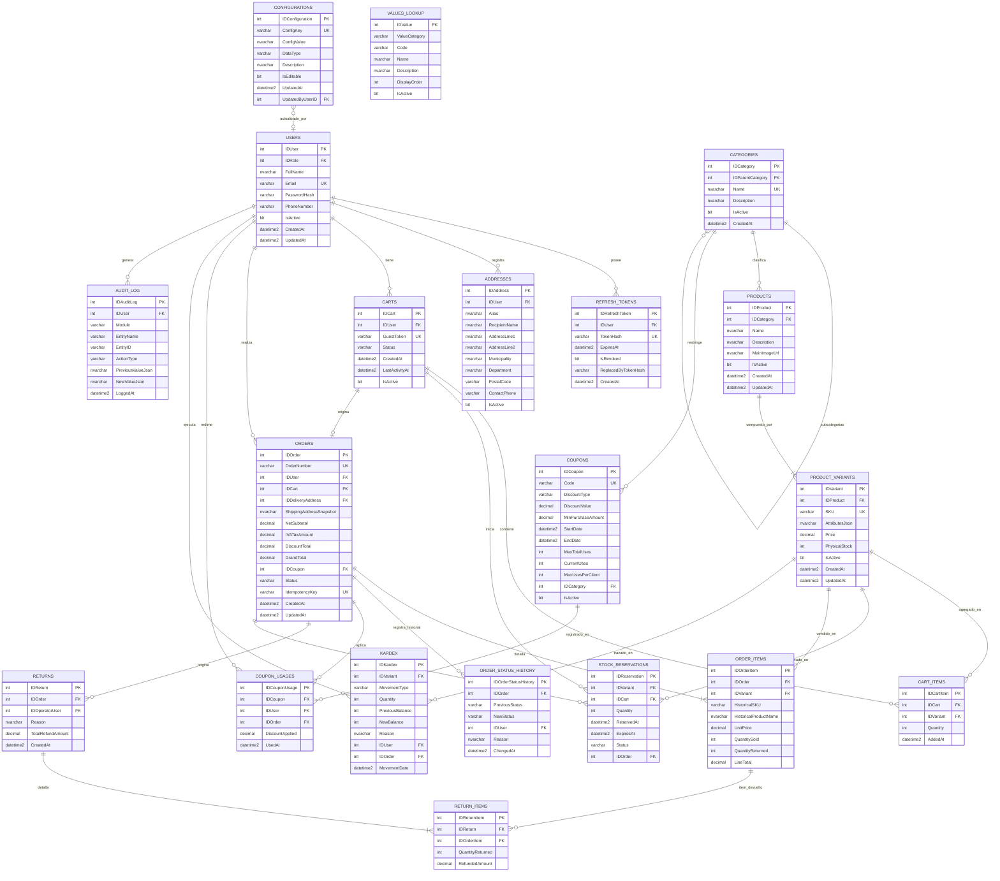
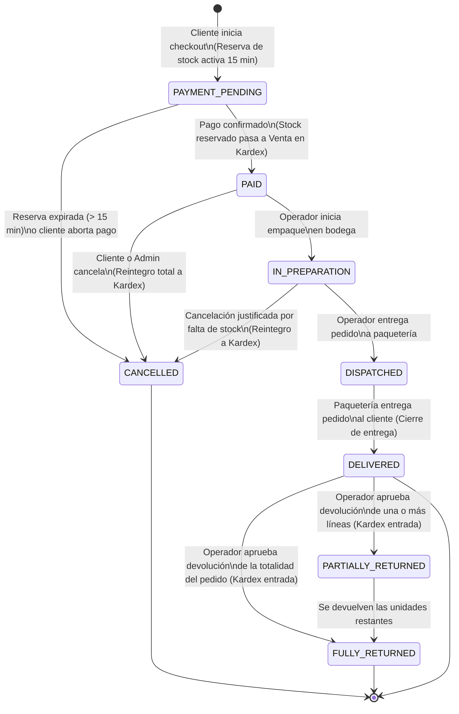

# ShopCart — Plataforma Web de Ventas (Nivel Productivo)

Proyecto desarrollado para el **Tech Challenge 360 (Grupo Pentandra)** evaluando el rol de Desarrollador Full Stack Middle / Senior.

ShopCart es una plataforma web de comercio electrónico de alto rendimiento y grado empresarial, diseñada con arquitectura en capas, garantías transaccionales ACID en Microsoft SQL Server, prevención rigurosa de sobreventa, auditoría inmutable y experiencia de usuario moderna en React.

---

## 1. Stack Tecnológico

| Capa | Tecnología | Justificación y Cumplimiento |
| :--- | :--- | :--- |
| **Base de Datos** | **Microsoft SQL Server 2022 / 2019+** | Modelo relacional fuertemente normalizado. Acceso a datos **exclusivamente mediante Stored Procedures** con parámetros tipados. Cero ORM. Tipos `DECIMAL(12,2)` e `INTEGER`. |
| **Backend** | **Node.js 24 LTS + Express + TypeScript** | Modo `strict`, arquitectura limpia en capas (Controladores $\rightarrow$ Servicios $\rightarrow$ Capa de Acceso a Datos), validación de esquemas con Zod, manejo centralizado de errores. |
| **Frontend** | **React 18+ + TypeScript + Vite** | Rutas protegidas por rol, paginación y filtros server-side, gráficos en dashboard, renovación transparente de tokens JWT, interfaz responsive con Tailwind CSS. |
| **Seguridad** | **Argon2 / Bcrypt + JWT Rotativo** | Tokens de acceso de corta duración (15 min) con refresh tokens rotativos, detección de reuso de tokens, cabeceras Helmet, CORS y aislamiento estricto de clientes. |

---

## 2. Instrucciones de Instalación y Ejecución

El proyecto está diseñado para ejecutarse en una máquina limpia siguiendo únicamente estos pasos:

### 2.1 Prerrequisitos
- Node.js 24 LTS o superior.
- Docker y Docker Compose (o una instancia local de SQL Server 2019+).
- Git.

### 2.2 Paso 1: Clonar el Repositorio
```bash
git clone https://github.com/Crstndfp/ShopCart.git
cd ShopCart
```

### 2.3 Paso 2: Levantar la Base de Datos con Docker
El repositorio incluye la configuración de Docker Compose para inicializar SQL Server 2022:
```bash
docker compose up -d
```
> **Nota:** La base de datos estará disponible en el puerto `1433` con el usuario `sa` y la contraseña `PentandraShopCart2026!`.

### 2.4 Paso 3: Inicializar y Sembrar la Base de Datos
Ejecuta el script automatizado para crear la base de datos, tablas, vistas, funciones, procedimientos almacenados y datos semilla:
```bash
./database/init_database.sh
```
O bien, ejecuta manualmente los 5 scripts en orden secuencial contra SQL Server:
1. `database/01_create_database_and_tables.sql`
2. `database/02_views.sql`
3. `database/03_functions.sql`
4. `database/04_stored_procedures.sql`
5. `database/05_seed_data.sql`

### 2.5 Paso 4: Configurar Variables de Entorno
Copia el archivo de ejemplo para el entorno del proyecto:
```bash
cp .env.example .env
```

### 2.6 Paso 5: Ejecutar Backend
```bash
cd backend
npm install
npm run build
npm run start
```
*El API quedará escuchando en `http://localhost:3000/api/v1`.*

### 2.7 Paso 6: Ejecutar Frontend
```bash
cd ../frontend
npm install
npm run dev
```
*La aplicación web estará disponible en `http://localhost:5173`.*

---

## 3. Credenciales de Prueba (Datos Semilla)

Todos los usuarios de prueba han sido inicializados con la contraseña por defecto: **`Password123!`**

| Rol | Correo Electrónico | Contraseña | Alcance y Permisos |
| :--- | :--- | :--- | :--- |
| **Administrador** | `admin@shopcart.gt` | `Password123!` | Acceso total: catálogo, precios, cupones, usuarios, bitácora de auditoría y reportes. |
| **Operador** | `operator@shopcart.gt` | `Password123!` | Preparación y despacho de pedidos, devoluciones y ajustes de inventario. |
| **Cliente** | `cliente@shopcart.gt` | `Password123!` | Navegación, carrito, checkout, gestión de direcciones y consulta de sus propios pedidos. |

### Cupones Promocionales Precargados:
- **`BIENVENIDA10`**: 10% de descuento en compras mayores a Q 200.00 (límite de 100 usos en total, 1 uso por cliente).
- **`PENTANDRA50`**: Q 50.00 de descuento fijo en compras mayores a Q 300.00 (límite de 50 usos en total, hasta 2 usos por cliente).

---

## 4. Decisiones Técnicas y Arquitectura

### 4.1 Monolito Modular vs. Microservicios
Para este reto se implementó un **Monolito Modular con Arquitectura en Capas**:
- **Atomicidad Transaccional Garantizada (ACID):** El requerimiento RF-06 exige que el pedido, sus líneas, la deducción de inventario y el consumo del cupón se guarden juntos o no se guarde nada. Distribuir esto en microservicios obligaría a implementar el patrón Saga o consistencia eventual, aumentando el riesgo de condiciones de carrera y sobreventa.
- **Rendimiento:** Un monolito modular aprovecha el motor transaccional de SQL Server con bloqueos pesimistas (`UPDLOCK`, `HOLDLOCK`), reduciendo la latencia de red a cero y garantizando respuestas en menos de 1 segundo.

### 4.2 Cero ORMs y Prevención de Inyección SQL
- No se utilizan ORMs (Prisma, TypeORM, Sequelize).
- Todo el acceso a datos se realiza mediante el driver nativo `mssql` invocando exclusivamente Stored Procedures (`SP_Module_Process`).
- Todos los parámetros son fuertemente tipados (`sql.Int`, `sql.Decimal`, `sql.VarChar`, `sql.DateTime2`), impidiendo de raíz cualquier inyección SQL.

### 4.3 Idempotencia en Checkout (RF-06)
- El cliente frontend genera un UUID único (`IdempotencyKey`) al entrar al flujo de pago.
- La tabla `Orders` cuenta con una restricción de unicidad (`UQ_Orders_IdempotencyKey`).
- Si un usuario presiona dos veces el botón de pagar o experimenta un reintento por falla de red, el Stored Procedure `SP_Orders_CreateOrder` detecta la clave existente y devuelve la orden previamente generada de forma limpia sin duplicar cobros ni pedidos.

### 4.4 Aislamiento Estricto de Clientes (Tenant Security)
- El Stored Procedure `SP_Orders_GetOrderByID` y los endpoints del backend verifican que el `IDOrder` consultado pertenezca al `IDUser` autenticado en el JWT (o que sea personal del staff `Operador`/`Administrador`).
- Si un cliente altera el identificador en la URL o en el cuerpo de la petición, el sistema responde inmediatamente `403 Forbidden` o `404 Not Found`.

---

## 5. Postura Frente a las Decisiones Abiertas del Reto

El enunciado del proyecto deja abiertas ciertas decisiones deliberadamente para evaluar el criterio técnico del participante. A continuación se fundamenta la postura adoptada:

### A. Fijación de Precios e Inventario a Nivel de Variante
- **Decisión:** Los precios y existencias físicas se gestionan en `ProductVariants` y no en el producto padre.
- **Fundamento:** En tiendas reales de ropa o tecnología, distintas variantes (ej. tallas XL o modelos de 256GB vs 128GB) tienen costos, márgenes y existencias independientes. El producto padre solo consolida la ficha técnica, categoría e imagen general.

### B. Cálculo del Impuesto (IVA 12% Incluido)
- **Decisión:** La tienda maneja precios públicos con IVA incluido en Quetzales (GTQ).
- **Fundamento:** Siguiendo la normativa tributaria guatemalteca (Decreto 27-92):
  $$\text{Base Imponible (Net Subtotal)} = \frac{\text{Total}}{1.12}$$
  $$\text{IVA (12\%)} = \text{Total} - \text{Base Imponible}$$
  Todos los cálculos se manejan con la función `FU_Orders_CalculateTaxes` y el tipo `DECIMAL(12,2)` para garantizar cero discrepancias por redondeo.

### C. Fusión de Carrito de Invitado (*Guest Cart Merge*)
- **Decisión:** Cuando un visitante anónimo con un token de carrito inicia sesión o se registra, el sistema ejecuta `SP_Cart_MergeGuestCart`.
- **Fundamento:** Se combinan los productos del carrito anónimo con el carrito persistente del usuario, sumando cantidades y validando la existencia disponible, mejorando la conversión de compra.
- **Unicidad del Carrito:** Se garantiza mediante un índice único filtrado (`UQ_Carts_ActiveUser WHERE IsActive = 1`) que un usuario autenticado solo tenga un carrito activo simultáneamente.

### D. Liberación Automática de Reservas Vencidas (> 15 minutos)
- **Decisión:** La reserva se registra en la tabla `StockReservations` con un timestamp `ExpiresAt`.
- **Fundamento:** Un worker en segundo plano (`node-cron`) en el backend ejecuta cada 60 segundos `SP_Inventory_ReleaseExpiredReservations`. Adicionalmente, la función de consulta de disponibilidad `FU_Catalog_AvailableStock` filtra en tiempo real únicamente reservas no expiradas (`ExpiresAt > SYSUTCDATETIME()`), garantizando liberación automática sin intervención manual.

### E. Definición de Carritos Abandonados
- **Decisión:** Se define un umbral configurable en la tabla `Configurations` (`CARRITO_ABANDONADO_HORAS = 24`).
- **Fundamento:** La vista `VW_Dashboard_AbandonedCarts` reporta cualquier carrito con estado `ACTIVE` cuyos productos no hayan tenido modificaciones en más de 24 horas (`DATEDIFF(HOUR, LastActivityAt, SYSUTCDATETIME()) >= 24`).

---

## 6. Diagrama Entidad-Relación (DER)



---

## 7. Ciclo de Vida del Pedido y Diagrama de Estados (RF-07)

El ciclo de vida del pedido implementa una máquina de estados estricta en el Stored Procedure `SP_Orders_AdvanceStatus` y la lógica de negocio del backend, con control de permisos por rol:



### Reglas de Transición y Devoluciones:
1. **Cancelación:** Solo permitida en estados `PAID` e `IN_PREPARATION`. Una vez el pedido pasa a `DISPATCHED`, **ya no puede cancelarse** (requiere entrega y proceso posterior de devolución).
2. **Reintegro Automático al Kardex:** Toda cancelación o devolución reingresa inmediatamente las existencias físicas a la base de datos con motivo auditable y usuario responsable.
3. **Control de Cantidad Devuelta:** Un `CHECK CONSTRAINT` en `OrderItems` garantiza que `QuantityReturned <= QuantitySold`, impidiendo que se devuelvan más unidades de las vendidas.
