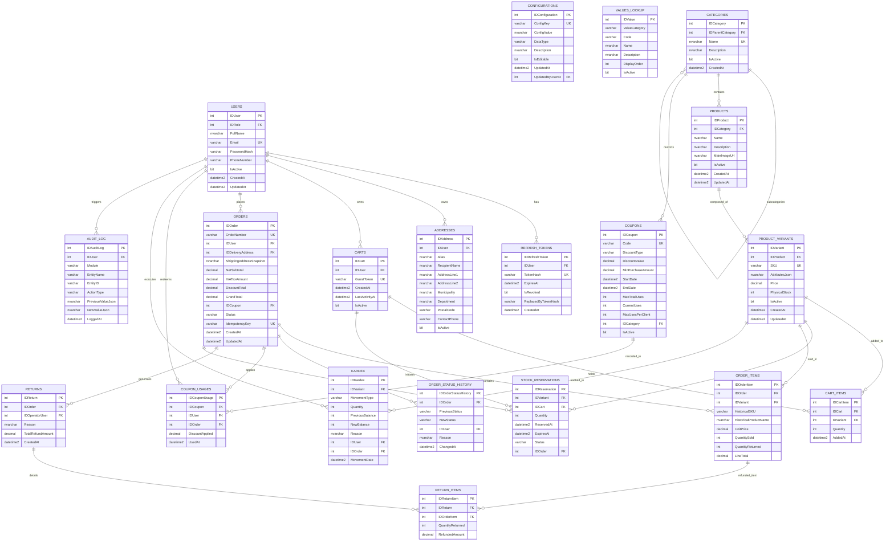

# ADR 001: Data Model, System Configuration, and Master Values Catalog

## 1. Context and Problem Statement
The ShopCart platform requires a fully normalized relational database in Microsoft SQL Server 2019+, strictly complying with ACID transaction guarantees, concurrency control (no overselling), auditability, automatic 15-minute reservation expiration, and 12% IVA tax compliance.

To avoid hardcoded operational parameters (such as the 12% IVA rate, 15-minute checkout reservation timeout, 24-hour abandoned cart threshold, token lifespans) and to formalize discrete domain states (roles, order states, kardex movement types, coupon discount types), we need:
1. A centralized `Configurations` table for runtime operational parameters.
2. A `Values` (Master Lookup) table for discrete business domain enumerations.
3. A fully normalized Entity-Relationship Model supporting all functional requirements (RF-01 through RF-09).

## 2. Architectural Decisions

### 2.1 System Configuration Table (`Configurations`)
Stores strongly-typed runtime key-value parameters governed by administrators without requiring code redeployment:
- `SYSTEM_IVA_PERCENTAGE`: `0.12` (12% IVA included in prices)
- `SYSTEM_CURRENCY_ISO`: `'GTQ'` (Guatemalan Quetzales)
- `INVENTORY_RESERVATION_MINUTES`: `15` (Hold duration during checkout)
- `CART_ABANDONED_HOURS`: `24` (Inactivity threshold for abandoned cart analytics)
- `AUTH_ACCESS_TOKEN_MINUTES`: `15`
- `AUTH_REFRESH_TOKEN_DAYS`: `7`

### 2.2 Master Values / Domain Lookup Table (`Values`)
Standardizes all discrete codes and statuses under a single extensible lookup table:
- `USER_ROLE`: `CLIENT`, `OPERATOR`, `ADMINISTRATOR`
- `ORDER_STATUS`: `PAYMENT_PENDING`, `PAID`, `IN_PREPARATION`, `DISPATCHED`, `DELIVERED`, `CANCELLED`, `PARTIALLY_RETURNED`, `FULLY_RETURNED`
- `KARDEX_MOVEMENT_TYPE`: `PURCHASE_ENTRY`, `SALE_EXIT`, `POSITIVE_ADJUSTMENT`, `NEGATIVE_ADJUSTMENT`, `CLIENT_RETURN`
- `RESERVATION_STATUS`: `ACTIVE`, `COMPLETED`, `EXPIRED`, `CANCELLED`
- `COUPON_DISCOUNT_TYPE`: `PERCENTAGE`, `FIXED_AMOUNT`
- `AUDIT_ACTION`: `CREATE`, `UPDATE`, `DEACTIVATE`

### 2.3 SQL Server Standards Compliance
- **Primary Keys**: `ID<Entity>` format (e.g. `IDProduct`, `IDOrder`, `IDCoupon`, `IDConfiguration`, `IDValue`).
- **Stored Procedures**: `SP_Module_Process` (e.g. `SP_Orders_CreateOrder`, `SP_Inventory_ReserveStock`).
- **Views**: `VW_Module_Process` (e.g. `VW_Dashboard_SalesByCategory`).
- **Table-Valued Functions**: `FU_Module_Process` (e.g. `FU_Coupons_CalculateDiscount`).
- **Monetary & Numeric Precision**: Strict `DECIMAL(12,2)` and `INTEGER`. `FLOAT` and `REAL` are strictly prohibited.
- **Data Access**: 100% through Stored Procedures with typed parameters. Zero ORMs and zero raw SQL strings.

## 3. Entity-Relationship Diagram (ERD)

